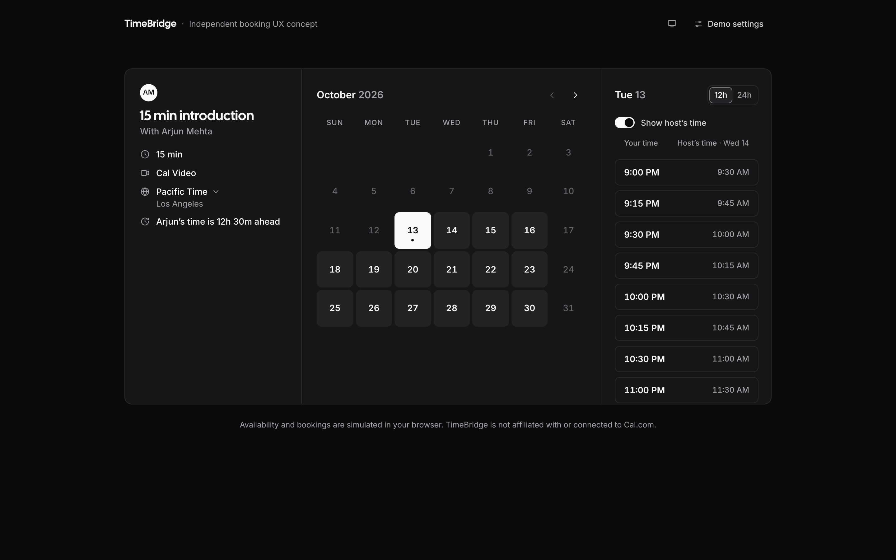
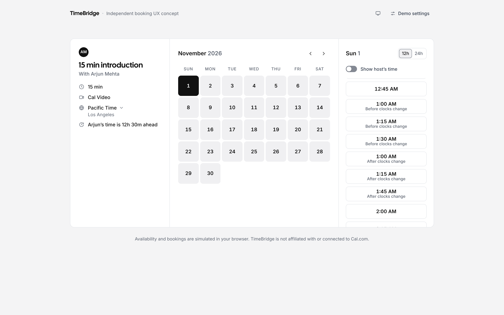

# TimeBridge

A booking-page concept for guests booking across time zones. It shows what the chosen time means for both people, at the moment it matters. TimeBridge is built as a focused evolution of Cal.com's booker, in React, TypeScript and Base UI.

> **Concept by Rashmi Basavaraj. Not affiliated with Cal.com.** Availability comes from a **simulated** service in this repository. Nothing here connects to Cal.com's booking backend.

**Live demo:** https://timebridge-nine.vercel.app/ · **Case study:** [`CASE_STUDY.md`](CASE_STUDY.md) · **Accessibility:** [`ACCESSIBILITY.md`](ACCESSIBILITY.md) · **Walkthrough script:** [`LOOM.md`](LOOM.md)



## The problem

When a host works 9–5 in India, a guest in Los Angeles is offered times around midnight, and nothing on the page says why. The times are converted correctly; what's missing is context. TimeBridge explores how little it takes to give that context without slowing anyone down. It is a hypothesis, not a validated fix: no user research has been done yet (see the case study).

## What it does

- **One line of context.** "Arjun's time is 12h 30m ahead", computed for the date being viewed, so it changes after a clock change. A short note appears only when a clock change falls between today and the chosen date.
- **Host's time on demand.** A switch adds the host's time beside each slot. The host's date is written only where it differs from the guest's.
- **Plain-language clock changes.** When clocks go back, a time that happens twice shows "Before clocks change" or "After clocks change" underneath, and one line above the list explains it. No zone abbreviations, and nothing extra on ordinary dates.
- **Two clocks, one meeting.** Details and confirmation show the guest's and host's date, time and zone, written out.
- **Host privacy.** Everything about the host appears only if the host shares their local time (`?share=off` turns it off).
- **Honest simulation.** Every page says availability and bookings are simulated. The confirmation says no invite was sent, and exported calendar events are titled "Simulated: …".



More screenshots, light and dark, desktop and phone, are in [`docs/screenshots/`](docs/screenshots).

## Stack and architecture

React 19, TypeScript 5.8 (strict), Vite 6, **Base UI** (`@base-ui/react`) and plain CSS with design tokens. Time-zone logic uses only the browser's `Intl` API and its IANA data; there is no date library. Tests use Vitest, Playwright and axe-core.

```
src/
  lib/time.ts                 time-zone primitives on Intl: offsets per instant, wall time ↔ instant (Temporal "compatible"), repeated-time detection, locale formatting
  lib/availability.ts         slot generation in the host's own zone
  lib/bridge.ts               every sentence the UI shows, as pure functions
  lib/calendarLinks.ts        .ics (RFC 5545 escaping and line folding) and Google Calendar links, in UTC
  lib/simulatedBookingService.ts   SIMULATED API: latency, failures, conflicts, re-validation at booking time
  hooks/useBooker.ts          booking-flow state and side effects
  components/                 rendering only (calendar grid, time list, zone picker, settings, form, confirmation, error boundary)
  styles/tokens.css           colour, radius and type tokens, light and dark
tests/unit, tests/e2e         Vitest; Playwright + axe-core
.github/workflows/ci.yml      audit, typecheck, lint, unit, build, then each browser project
```

**Base UI, not coss ui.** Cal.com's coss ui is built on Base UI with Tailwind. TimeBridge uses the same Base UI primitives directly (Combobox, Popover, Dialog, Select, Menu, Switch, Toggle Group), styled with its own tokens and one shared popup layer. Adding Tailwind just to use coss ui wasn't worth it for a single-page concept; the case study maps each part to its coss ui counterpart.

**Principles:** offsets are looked up for the exact instant, never added as constants; every sentence comes from a tested pure function; components only render; the time list is native buttons with one tab stop.

## Accessibility

Targeting WCAG 2.2 AA. Checked automatically on every run:

- axe-core, with zero violations across the main states, in light and dark
- contrast of text and of control edges (≥ 3:1), from the design tokens and on the rendered page
- keyboard-only booking, the calendar grid and time-list keys, and focus after every step change
- reflow down to 375 px, 24 px targets and reduced motion

**No manual screen-reader testing has been done.** [`ACCESSIBILITY.md`](ACCESSIBILITY.md) lists what was checked, what wasn't, and a checklist for VoiceOver, NVDA, JAWS and TalkBack. Passing axe is not a conformance claim.

## Time zones and clock changes

- Offsets come from IANA data for each instant. Clock changes are found by scanning that data, never from a list of dates.
- Wall-clock times convert like Temporal's "compatible" rule: a repeated time takes the earlier instant, and a skipped time moves past the gap.
- Tests cover Los Angeles, New York, London, Sydney, Adelaide (UTC+10:30) and Lord Howe (a 30-minute change) for 2026–2029, against hand-derived UTC instants. They also cover India, Nepal (UTC+5:45) and Tokyo, which have no changes, plus leap days and dates across months and years.
- Each repeated slot keeps its own UTC instant through details, confirmation, `.ics` and Google Calendar.

## Running it

Requires Node 20.19 or newer.

```bash
npm install
npm run dev                  # http://localhost:5173/?tz=America/Los_Angeles
```

| URL parameter | Example | Purpose |
|---|---|---|
| `tz` | `?tz=Europe/London` | Guest's time zone (default: this device's) |
| `now` | `&now=2026-10-13T15:30:00Z` | Pin the starting time for demos and tests; the clock still advances |
| `share` | `&share=off` | A host who hasn't allowed their local time to be shown |
| `schedule` | `&schedule=every-day` | Test fixture: host hours every day. Arjun's weekday hours never reach a repeated hour, so this shows that case |

**Demo settings** (top right) is the prototype's control panel, not part of the booking page: the guest zone, the host's privacy setting, and simulated slow, failed and conflicting requests.

## Checks

```bash
npm run typecheck
npm run lint                 # typescript-eslint, React hook rules, jsx-a11y
npm test                     # Vitest
npm run test:e2e:install     # once: Chromium, Firefox and WebKit with system dependencies
npm run test:e2e             # all five browser projects
npm run test:e2e:chromium    # Chromium only
npm run build
```

**Last verified run:** [GitHub Actions run 39378723227](https://github.com/rashmi09-sys/timebridge/actions/runs/39378723227), 2026-10-20, on `ubuntu-latest` with Node 22 and Playwright 1.56 (Chromium 141, Firefox 142, WebKit 26).

| Check | Result |
|---|---|
| Typecheck, lint, unit tests, production build | Pass (184 unit tests; count from a local run of the same code) |
| desktop-chromium | 104 passed, 0 failed, 1 skipped |
| desktop-firefox | 104 passed, 0 failed, 1 skipped |
| desktop-webkit | 104 passed, 0 failed, 1 skipped |
| mobile-chromium (Pixel 7, emulated) | 84 passed, 0 failed, 21 skipped |
| mobile-webkit (iPhone 13, emulated) | 84 passed, 0 failed, 21 skipped |
| `npm audit` | 0 vulnerabilities |

Skips are deliberate: keyboard and fixed-width tests run on desktop, and phone-only tests on phones. No tests were retried.

These are Playwright's own Linux builds of each engine. WebKit on Linux is not Safari on a Mac or an iPhone, and the phone projects emulate screen size and touch; they are not real devices.

## Limitations

- **Simulated.** One fictional host, Arjun Mehta in Bengaluru (Mon–Fri 9:00–17:00, 15-minute meetings, 2-hour notice, 60-day window). Yuki Tanaka in Tokyo appears only as placeholder text. Nothing is booked, sent or stored.
- **Not verified:** screen readers by ear, real phones, Windows High Contrast, and the shipping browsers themselves (Safari, Chrome and Firefox on macOS, Windows, iOS and Android). Automated tests cover Playwright's Chromium, Firefox and WebKit builds only.
- **Focus ring in older Safari.** Keyboard moves in the calendar and time list call `focus({ focusVisible: true })`, supported from Safari 18.4, Firefox 104 and Chrome 145. Safari before 18.4 ignores it, so after a mouse click, arrowing through dates or times there may show no focus ring. Chrome before 145 shows the ring through its own rules (tested in Chromium 141).
- **Interface copy is English only.** Dates and times follow the browser's locale; sentences and zone names don't, and weeks start on Sunday everywhere.
- **No user research.** Whether guests actually hesitate without this context is the open question.

## AI assistance

TimeBridge was built with AI-assisted development: Claude (through Claude Code) wrote much of the code, tests and documentation under my direction. I set the product questions, the design direction and constraints, reviewed the changes, and decided what to keep or reject; several features were built and then removed after review (night-time markers, a docked settings drawer, zone abbreviations on slots). Claims in these documents are limited to what the automated checks and my own reviews verified; anything not verified is marked as such.

## Licence

No licence has been chosen yet. Public source code without a licence can be read, but not legally reused, modified or redistributed. If one is added, a permissive licence such as MIT fits a portfolio project.

## Independence

TimeBridge is an independent concept. It is not affiliated with, endorsed by or connected to Cal.com. "Cal.com", "Cal Video" and "Cal Sans" belong to their owners; Cal Sans is used under its open font licence via `@fontsource/cal-sans`.
